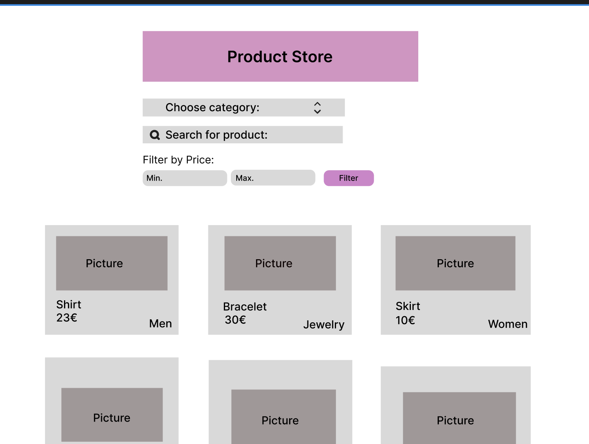
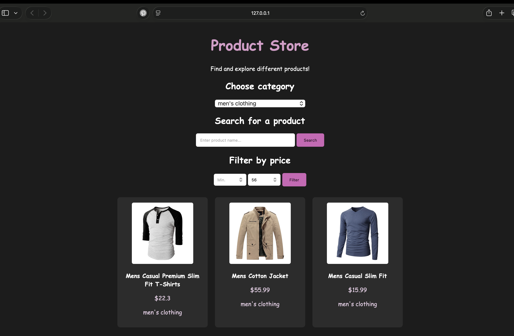
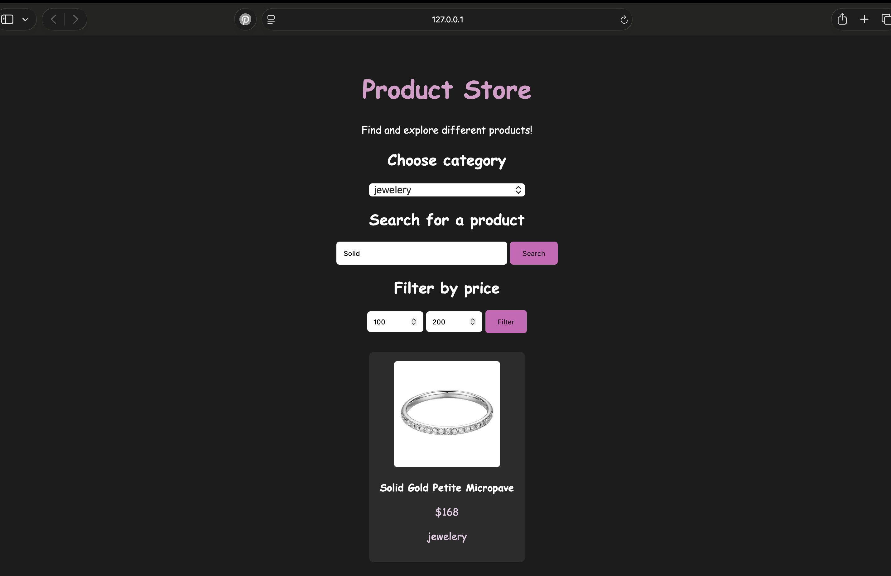

# Product Store

**Tekijä(t):** Silja Jahnukainen

## Projektisuunnitelma

### Projektin idea

Käyttäjä voi etsiä tuotteita. Sovellus hakee tuotteiden tietoja Fake Store API:sta. Käyttäjä voi etsiä hakusanalla tai valita kategorian.  Verkkosivulla näkyy tuotteen nimi, kuva, hinta sekä kategoria. 

### Suunnitellut toiminnot

- Käyttäjä voi hakea tuotteita valitsemalla kategorian, esimerkiksi korut.
- Käyttäjä voi hakea nimellä tuotetta.
- Hintasuodattimen avulla voi rajata tuotteita tietyn hintavälin mukaan.

### Rautalankamalli / luonnos

## Verkkolinkit

- **Julkaistu sovellus:** 
- **GitHub-repositorio:** [https://github.com/Siljah18/Projekti-2a]
- **Projektin videoesittely:** [https://video.laurea.fi/media/Product+store+video/0_y56tjdfo]

## Tietoja sovelluksesta

**[Product Store]** on verkkosovellus, jossa voi etsiö tuotteita hakusanan, kategorian tai hinnan mukaan. Sovellus hakee tuotetiedot Fake Store API -rajapinnasta. Tuotteesta näytetään kuva, nimi, hinta sekä sen kategoria.

## Teknologiat

Käytin HTML:ää sivun rakenteen tekemiseen, esimerkiksi hakukenttiin ja painikkeisiin. CSS:ää käytin hienon ulkoasun toteuttamiseen, eli fonttien, painikkeiden ja asettelun muokkaamiseen. JavaScriptiä käytin toimintojen toimivuuden mahdollistamiseen. Lisäksi se mahdollisti tuotetietojen hakemisen Fake Store API:sta. Käytin myös DOM-skriptausta tuotteiden lisäämiseen verkkosivulle. Käytin Fetch API:a hakemaan tuotetiedot API-rajapinnasta.

## Sovelluksen käyttö

Kirjoita lyhyet käyttöohjeet sovellukselle.

1. Avaa julkaistu sovellus yllä olevasta linkistä.
2. Selaa tuotteita verkkosivulla.
3. Hae tuotetta kirjoittamalla nimi hakukenttään tai valitsemalla kategoria. 
4. Paina Search -painiketta saadaksesi tulokset.
4. Voit myös suodattaa hakutuloksia määrittämällä minimi- ja maksimihinnan ja painamalla Filter -painiketta.
5. Hakutulokset päivittyy näytölle.

## Sovelluksen käynnistäminen paikallisesti

1. Kloonaa tai lataa tämä repositorio omalle koneellesi.
2. Avaa projektikansio.
3. Avaa `index.html` selaimessa.

## Kuvakaappaukset

## Tunnetut virheet / puutteet

**Ei tunnettuja virheitä.**

## Oma arvio ja oppimisen reflektointi

Onnistuin tekemään oikeat koodit projektin toimimisen saavuttamiseksi. Haastavaa oli API:n käyttäminen ja sen toiminnan ymmärtäminen. Sain kuitenkin tehtyä toimivan API-kutsun. Jos aikaa olisi enemmän, tekisin sovellukseen lisää monipuolisia toimintoja, jotka parantavat sen käytettävyyttä. Tekisin esimerkiksi "Lisää suosikiksi" -toiminnon. 

Opin paljon lisää JavaScriptistä ja sen toiminnoista sekä miten voin hyödyntää APIa tietojen hakemiseen verkkosivulla. HTML ja CSS olivat minulle jo tutumpia, joten pääsin hyödyntämään omaa osaamista verkkosivun rakenteeseen ja ulkoasuun liittyen.

Haluaisin oppia ymmärtämään lisää erilaisia koodin käskyjä ja hahmottamaan, missä tilanteissa niitä käytetään. Lisäksi haluan oppia lisää API-rajapintojen hyödyntämisestä erilaisissa sovelluksissa. Epäselväksi jäi virhetilanteiden ratkaiseminen API-rajapintoihin liittyen. Esimerkiksi se, että miksi joidenkin yritysten API-rajapinnat ei toimi odotetusti. Onnistuin kuitenkin tekemään toimivan sovelluksen ja täytin mielestäni kaikki kriteerit.

Oma arvio projektista: **10/10 pistettä**

## Lähteet ja kiitokset

- [freeCodeCamp - How to Use Fetch to Make AJAX Calls in JavaScript](https://www.freecodecamp.org/news/how-to-use-fetch-api/)
- [W3Schools - The Logical AND operator (&&)](https://www.w3schools.com/jsref/jsref_oper_and.asp)
- [W3Schools - The select element](https://www.w3schools.com/tags/tryit.asp?filename=tryhtml_select)
- [MDN Web Docs - HTML input element](https://developer.mozilla.org/en-US/docs/Web/HTML/Reference/Elements/input)
- [Fake Store API](https://fakestoreapi.com )

- Käytetty tekoälytyökalu: ChatGPT
  - Käytettiin koodin toiminnan ymmärtämiseen ja joidenkin JavaScript -toimintojen luomiseen sekä koodin virheiden etsimiseen. 

  ## Lisenssi

Tämä projekti on lisensoitu MIT-lisenssillä.

Lisätietoa lisenssin lisäämisestä GitHub-projektiin:
https://docs.github.com/en/communities/setting-up-your-project-for-healthy-contributions/adding-a-license-to-a-repository